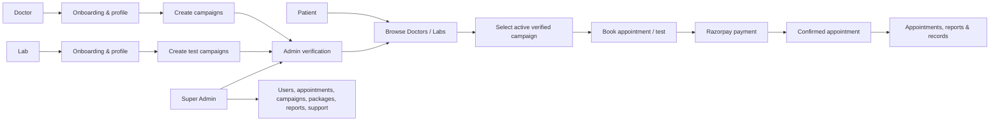

# Swasthify — Project Overview

Swasthify is a multi-role healthcare marketplace for Bihar and Patna. Patients can discover verified doctors and diagnostic labs, book appointments or tests, pay online, manage health records, and contact support. Dedicated operational portals support doctors, and super administrators.

## Core User Flows

### Patient Journey

1. Register or sign in, then browse available doctors and labs.
2. Select a verified, active campaign.
3. Create a pending booking; pricing includes campaign discounts and platform fees.
4. Complete payment through Razorpay. A verified payment confirms the appointment and sends a confirmation email.
5. Access appointments, reports, health records, and account settings from the patient portal.

### Provider and Administration Journey

- Doctors and labs submit onboarding details and documents, complete their profiles, create campaigns, and manage operations in their own dashboards.
- Super administrators verify providers and manage user status and permissions, campaigns, appointments, health packages, specialties, documents, tickets, notifications, analytics, and platform settings.
- A scheduled cleanup endpoint removes unpaid pending appointments after 30 minutes.
- Doctor package renewals run daily at 02:00 UTC through Vercel Cron. Set `CRON_SECRET` in Vercel Production environment variables; Vercel sends it to the worker as a bearer token. `DOCTOR_PACKAGE_GRACE_DAYS` is optional and defaults to `7`.

## Portals

| Area | Purpose |
| --- | --- |
| Public website | Marketing pages, services, specialties, pricing, contact, FAQs, and doctor/lab discovery. |
| Patient portal (`/me`) | Profile, appointments, health records, reports, and settings. |
| Doctor panel (`/doctor-panel`) | Dashboard, profile, campaigns, appointments, patients, analytics, pricing, and settings. |
| Lab panel (`/lab-panel`) | Dashboard, profile, campaigns, tests, appointments, reports, and settings. |
| Super admin (`/superAdmin`) | Platform operations, user and document review, campaigns, analytics, support, and configuration. |

## Main Data Model

The PostgreSQL/Prisma schema centers around:

- **Users and access:** Role-based users for patients, doctors, labs, admins, and super admins, with separate patient, doctor, and lab profiles.
- **Bookable services:** Campaigns for doctor OPDs, health camps, free checkups, and laboratory offerings.
- **Bookings and payments:** Appointments, payments, platform fees, coupons, discounts, and queue numbers.
- **Healthcare and platform operations:** Medical records, prescriptions, medications, lab reports, uploads, reviews, favorites, insurance, wallets, notifications, audit logs, and analytics events.

## Technology

| Area | Technology |
| --- | --- |
| Frontend / full stack | Next.js 16, React 19, and TypeScript |
| Styling and UI | Tailwind CSS 4, Radix UI, shadcn-style components, Lucide, Framer Motion, and Sonner |
| Database | PostgreSQL, Prisma 7, and the Prisma PostgreSQL adapter |
| Authentication | Custom JWT authentication in role-specific HTTP-only cookies, bcrypt password hashing, Firebase / Identity Platform mobile OTP, and Google authentication support |
| Payments | Razorpay order creation and HMAC signature verification |
| Storage | AWS S3 for profile images and verification/document uploads |
| Email | Resend with React Email onboarding and appointment templates |
| AI assistant | Gemini API with embedding-based retrieval over a local healthcare/product knowledge base |
| Analytics | Custom visitor, page-view, and event collection with device/browser parsing and dashboard reporting |
| Charts, tables, and forms | Recharts, TanStack Table, React Hook Form, and Zod |
| SEO | Metadata, sitemap generation, structured public pages, and Open Graph/Twitter metadata |

## Project Structure

| Path | Responsibility |
| --- | --- |
| [`app`](./app) | Routes, pages, layouts, and server API endpoints. |
| [`components`](./components) | Reusable UI and patient, doctor, lab, admin, analytics, and chatbot components. |
| [`lib`](./lib) | Database, payment, storage, Firebase, email, validation, and analytics helpers. |
| [`prisma/schema.prisma`](./prisma/schema.prisma) | Complete relational data model and migrations. |
| [`middleware.js`](./middleware.js) | Role-aware route protection and redirects. |

## Summary

Swasthify is an end-to-end healthcare platform: public discovery and booking for patients, alongside full provider and administrator operations for managing healthcare delivery.
